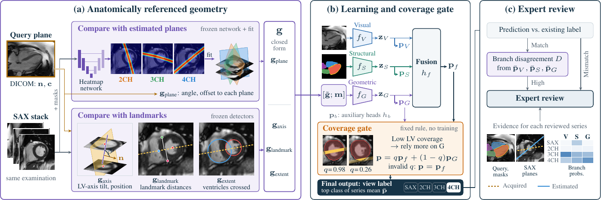

# CMR-Compass

Code for **"CMR-Compass: Cardiac MRI View Classification with Patient-Specific Geometry and Disagreement-Guided Expert Review"** (ISBI 2027 submission).

## What this repository does

A cardiac MRI examination is a set of 2D series acquired in standard planes: a short-axis (SAX) stack and two-, three- and four-chamber (2CH/3CH/4CH) long-axis views. The view is usually recorded only in a free-text DICOM series description. That text is not standardized and can be wrong or missing, so large datasets have to be checked before view-specific analysis.

CMR-Compass classifies each cine or late gadolinium enhancement (LGE) series as SAX, 2CH, 3CH or 4CH, and points experts to series that need a look. It uses three branches:

- **Visual (V):** the image.
- **Structural (S):** the image's predicted anatomical masks.
- **Geometric (G):** the image's plane measured against the patient's own heart. A plane network first estimates where the standard long-axis planes lie, using a SAX stack from the same examination. The image's plane is then compared with those planes and with SAX landmarks.

A coverage gate leans on the geometric branch when the image shows little of the left ventricle (LV). Experts then review two kinds of series:

- Series whose prediction does not match the existing label.
- Series where the three branches disagree, even though the prediction is correct, since these can still be off-plane, incomplete or of poor quality.



*Figure 1 of the paper. (a) Frozen networks locate the patient's long-axis planes and SAX landmarks, and the descriptor **g** measures the query image against them. (b) Visual, structural and geometric features are fused; low LV coverage q shifts weight to the geometric head. (c) Mismatches and series with high branch disagreement go to experts.*

This repository contains the code to train the models and run inference. **No data or trained weights are included**, so you need your own CMR data in the format described below.

## Pipeline

```
manifest.jsonl ─► 1 preprocess ─► images/masks cache, patient-level folds
               └► 2 pair ───────► SAX reference stack per exam + plane-network targets
                  3 train_plane_net (per fold) ─► out-of-fold intersection lines on SAX slices
                  4 build_geometry ─► 16-value descriptor per image (+ coverage q)
                  5 train (per fold, per seed) ─► CMR-Compass checkpoints
                  6 predict ─► series predictions (gated, fused, per branch)
                  7 review_queue ─► mismatches + top-10% branch disagreement
```

| Paper section | Code |
|---|---|
| Geometric descriptor: plane network and plane fitting | `cmr_compass/plane_net.py`, `geometry.fit_plane` |
| Geometric descriptor: Eqs. 1–2 and the SAX-anatomy groups | `geometry.cardiac_frame`, `geometry.descriptor` |
| V–S–G learning and fusion (Eqs. 3–4) | `cmr_compass/model.py`, `scripts/train.py` |
| Coverage gate (Eqs. 5–6) | `cmr_compass/coverage.py`, `model.coverage_gate` |
| Expert review workflow (Eq. 7) | `cmr_compass/review.py` |

## Install

```sh
pip install -r requirements.txt
```

The paper's runs used Python 3.10, PyTorch 2.6 and torchvision 0.21 on a GPU. The smoke tests also pass on CPU with PyTorch 2.15.

## Input data

There is one JSON line per 2D image in `manifest.jsonl`. The manifest should contain only cine and LGE images of the four target views.

```json
{"sample_id": "...", "patient_id": "...", "scan_id": "...", "series_uid": "...",
 "dataset": "...", "modality": "cine | LGE", "subtype": "sequence | MAG | PSIR",
 "view": "sax | 2ch | 3ch | 4ch", "series_description": "...",
 "image": "path/to/native_pixels.npy", "mask": "path/to/native_bitmask.npy",
 "dicom_tags": {"ImagePositionPatient": [...], "ImageOrientationPatient": [...], "PixelSpacing": [row, col],
                "Rows": 0, "Columns": 0, "SliceThickness": 0, "FrameOfReferenceUID": "..."}}
```

- `image`: 2D native pixels in DICOM row/column order, with rescale slope and intercept applied.
- `scan_id`: one examination; it must be unique across the dataset.
- `view`: the reference label, used for training and evaluation. Internally, it also identifies the SAX series used to build the reference stack.

### Outputs of frozen upstream models (not included)

The method uses four pretrained models that stay frozen. Their outputs are read from files:

| Model | Used for | File |
|---|---|---|
| 6-class segmentor (LV cavity, LV epicardium, LA, RV, RA, RVOT) | structural branch, plane network, coverage | `mask` in the manifest: uint8 bitmask on the native grid, bit *k* = class *k* in that order |
| LV/RV bounding-box detector | cardiac frame, landmark and extent features | `sax_detections.jsonl` |
| RV insertion-point keypoint detector | landmark features | `sax_detections.jsonl` |
| SAX slice-location classifier (apex/mid/base) | coverage gate only | `sax_location.jsonl` (optional) |

`sax_detections.jsonl` has one line per SAX image, in native pixel coordinates:

```json
{"sample_id": "...", "lv_box": [x1, y1, x2, y2, conf], "rv_box": [x1, y1, x2, y2, conf],
 "rvip_ant": [x, y], "rvip_inf": [x, y]}
```

For `lv_box`, use the LV blood-pool box, or the LV myocardium box when the blood pool is not detected. Missing detections can be `null` or left out.

`sax_location.jsonl`: `{"sample_id": "...", "probabilities": {"apex": p, "mid": p, "base": p}}`

Without `sax_location.jsonl`, the gate stays inactive and predictions use the fused head. The external evaluation in the paper ran this way.

## Running

All commands run from the repository root. Defaults are the paper's settings.

```sh
# 1. cache images/masks (1.25 mm, 256 px) and assign five patient-level folds
python -m scripts.preprocess --manifest data/manifest.jsonl --out work/cache

# 2. SAX reference stack per examination (cine > LGE MAG > LGE PSIR) and plane-network targets
python -m scripts.pair --manifest data/manifest.jsonl --out work/pairing.json

# 3. plane network, out of fold (repeat for folds 0..4)
python -m scripts.train_plane_net --manifest data/manifest.jsonl --cache work/cache \
    --pairing work/pairing.json --fold 0 --out work/plane_net

# 4. geometric descriptor (and coverage, if slice-location outputs are given)
python -m scripts.build_geometry --manifest data/manifest.jsonl --pairing work/pairing.json \
    --lines work/plane_net/fold*/lines.json --detections data/sax_detections.jsonl \
    --sax-location data/sax_location.jsonl --out work/geometry.npz

# 5. CMR-Compass (repeat for folds 0..4 and seeds 0..2)
python -m scripts.train --manifest data/manifest.jsonl --cache work/cache --geometry work/geometry.npz \
    --fold 0 --seed 0 --out work/cmr_compass_s0

# 6. held-out predictions of one fold, with the coverage gate
python -m scripts.predict --manifest data/manifest.jsonl --cache work/cache --geometry work/geometry.npz \
    --checkpoints work/cmr_compass_s0/fold0/best.pt --folds work/cache/folds.json --fold 0 \
    --out work/pred_fold0.csv

# 7. review queue (concatenate the five held-out fold CSVs first)
python -m scripts.review_queue --predictions work/pred_series.csv --out work/review_queue.csv
```

For step 7, the paper's internal review used seed-0 held-out predictions of the series from patients with a SAX reference.

**Ablations.** Use `--branches visual`, `--branches structural`, `--branches geometric` or `--branches visual structural` in step 5. "Ours w/o gate" is the `fused` column of the step-6 output.

**External data.** Run steps 1, 2 and 4 on the external manifest. Pick SAX series with a frozen visual-only model by passing `--sax-views predictions.csv` (columns `series_uid,pred_view`) to step 2. Predict planes with trained plane networks (`train_plane_net --checkpoint .../model.pt`). Then pass all five fold checkpoints of a seed to `predict` as one ensemble.

**Training details** (`scripts/train.py`):
- Loss: cross-entropy on the fused head plus 0.3 × the auxiliary branch losses, with label smoothing 0.05.
- Optimizer: AdamW (lr 3e-4, weight decay 1e-4), batch size 64, 30 epochs, one warm-up epoch, then cosine decay.
- Sampling and augmentation: series- and class-balanced sampling, with shared affine augmentation of images and masks.
- Checkpoint selection: validation series macro-F1.
- Geometric features are standardized with training-fold statistics, which are stored in the checkpoint.

## Tests

```sh
python -m pytest tests
```

The tests use synthetic inputs on CPU and take about a minute. They check the model, the gate, plane fitting, the descriptor, coverage and the disagreement score, and run all seven steps end to end on a tiny synthetic dataset.

## Not included

- Patient data, splits and trained weights.
- The four frozen upstream models above.
- The CardiSort and Vergani et al. baseline adaptations.

The paper's models were trained on the Yale training folds plus an additional cine development cohort of 313 patients without SAX references.

For questions, contact the corresponding author listed in the paper.
